<p align="center">
  <a href="https://echoness.itch.io/solar-system">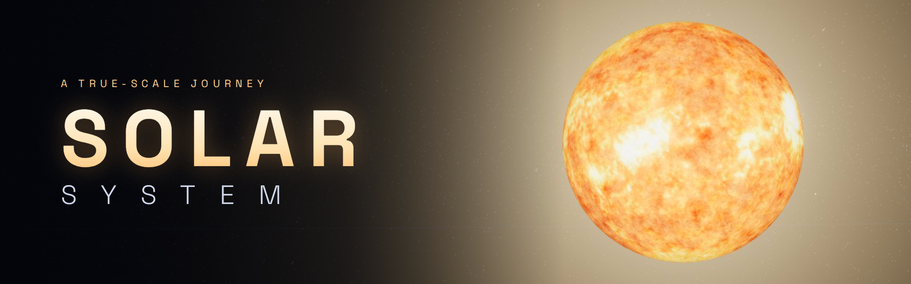</a>
</p>

<p align="center">
<!-- auto:badges -->
<a href="https://echoness.itch.io/solar-system"></a>
<a href="https://e-choness.github.io/solar-system-engine/"></a>
<a href="https://github.com/e-choness/solar-system-engine/actions/workflows/publish.yml"></a>
<br>
  <a href="LICENSE.md"></a> <a href="https://threejs.org"></a>  <a href="https://svelte.dev"></a> <a href="https://vite.dev"></a> <a href="https://www.typescriptlang.org"></a> <a href="#development"></a>
<!-- /auto:badges -->
</p>

<p align="center"><b>Fly from the Sun’s fire to the frozen edge of the Oort cloud — every world where it really is, right now.</b></p>

**Solar System** is a true-scale, real-time model of our Solar System that runs in the browser. Every planet, major moon, dwarf planet and famous comet sits at its real position for any date between 1800 and 2200, wrapped in spacecraft surface maps, lit by a physically placed Sun, and paired with the sound of each world.

It is a ground-up remake of the [original 2021 Unity game](https://echoness.itch.io/solar-system), rebuilt on WebGPU with a glass interface and far more to explore.

### ▶ [Play it free on itch.io](https://echoness.itch.io/solar-system) or [GitHub Pages](https://e-choness.github.io/solar-system-engine/) · [Watch the trailer](media/trailer.mp4)

<p align="center"><a href="media/trailer.mp4">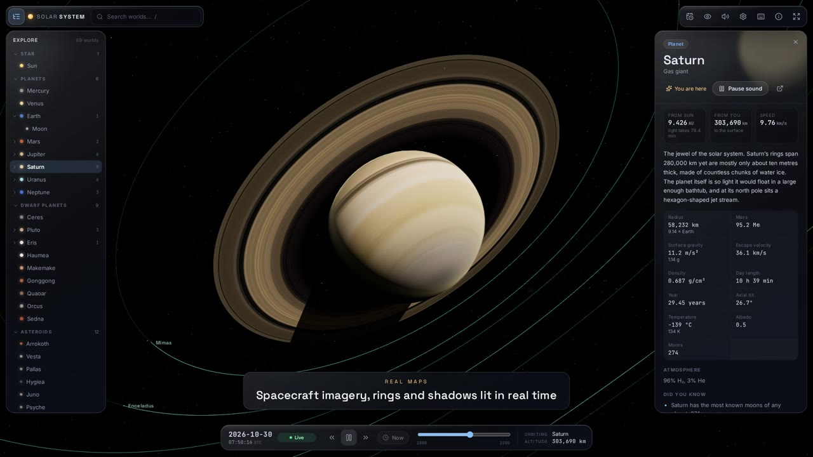</a></p>

## Highlights

<!-- auto:stats -->
| | |
| --- | --- |
| 🪐 **Worlds** | 69: the Sun, 8 planets, 31 moons, 9 dwarf planets, 12 asteroids & Kuiper belt objects, 8 comets |
| 🛰️ **Surface maps** | 35 from spacecraft imagery, 3 artist’s impressions, procedural GPU surfaces for the rest |
| 🎧 **Sound** | original soundtrack, 9 original world sounds, 2 spacecraft recordings, 58 live sonifications |
| ✨ **Sky** | 8,355 real stars from the Yale Bright Star Catalogue, the Milky Way, asteroid belt, Trojans, Kuiper belt and Oort cloud |
| 🕰️ **Time** | any moment from 1800 to 2200, 21 one-click historic and upcoming events |
<!-- /auto:stats -->

- **True scale, no tricks.** Distances, sizes and orbits are real. A floating-origin camera with 64-bit positions lets you skim 20 km above an asteroid, then pull back to see the whole Kuiper belt.
- **Real positions for any date.** JPL planetary elements and Horizons orbits put every body where it is today, or where it was when Voyager 2 reached Neptune. Moons are tidally locked and planets spin on IAU pole models.
- **A world you can read.** Click anything to open a glass panel with live distance, speed and light-time, physical data, discovery history, missions and facts.
- **Hear every world.** The original soundtrack returns, alongside the original world sounds, NASA Juno recordings of Europa and Ganymede, and live sonifications built from each body’s size, spin and temperature.
- **Cinematic rendering.** Atmospheric scattering, city lights on the night side, cloud layers, ring shadows on Saturn, procedural surfaces for unmapped worlds, GPU-simulated asteroid belts, comet ion and dust tails, bloom and lens flare.
- **Time travel.** Scrub four centuries or jump to events: Apollo 11, Shoemaker–Levy 9, New Horizons at Pluto, the 2029 Apophis flyby, Halley’s 2061 return.

## Screenshots

<!-- auto:gallery -->
<table>
  <tr>
    <td width="50%">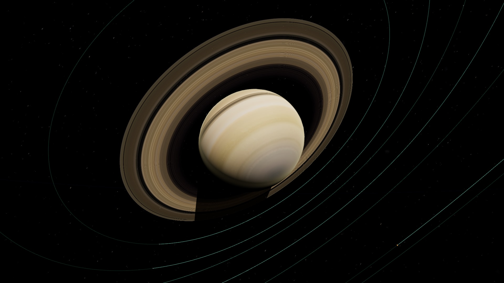<br><sub>Saturn and its rings, lit and shadowed in real time</sub></td>
    <td width="50%">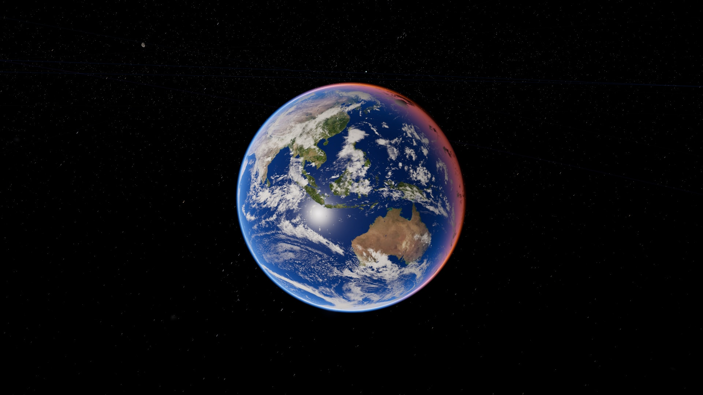<br><sub>Earth with live clouds, city lights and atmosphere</sub></td>
  </tr>
  <tr>
    <td width="50%">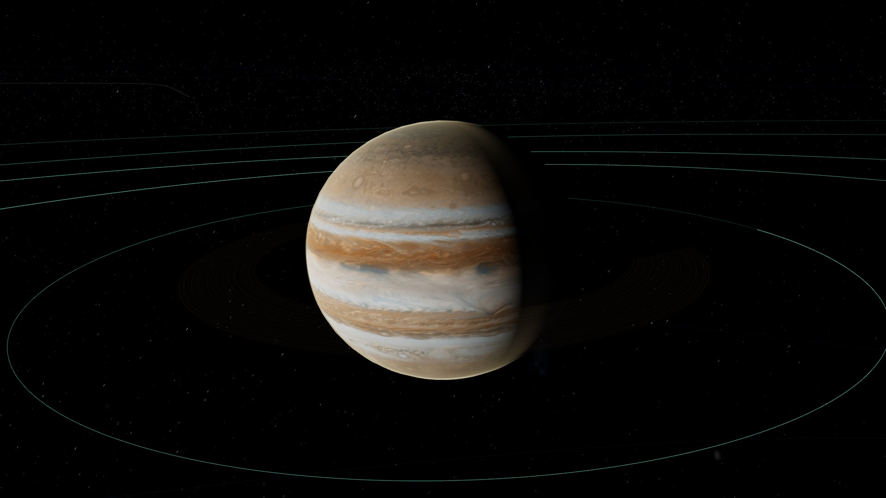<br><sub>Jupiter at its true position for the current date</sub></td>
    <td width="50%">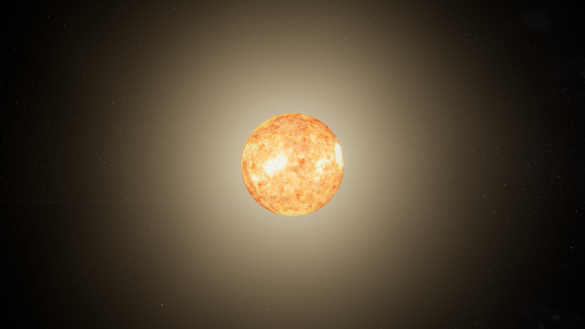<br><sub>The Sun’s boiling photosphere</sub></td>
  </tr>
  <tr>
    <td width="50%">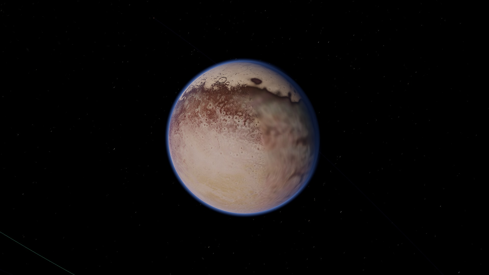<br><sub>Pluto and its heart, from New Horizons maps</sub></td>
    <td width="50%">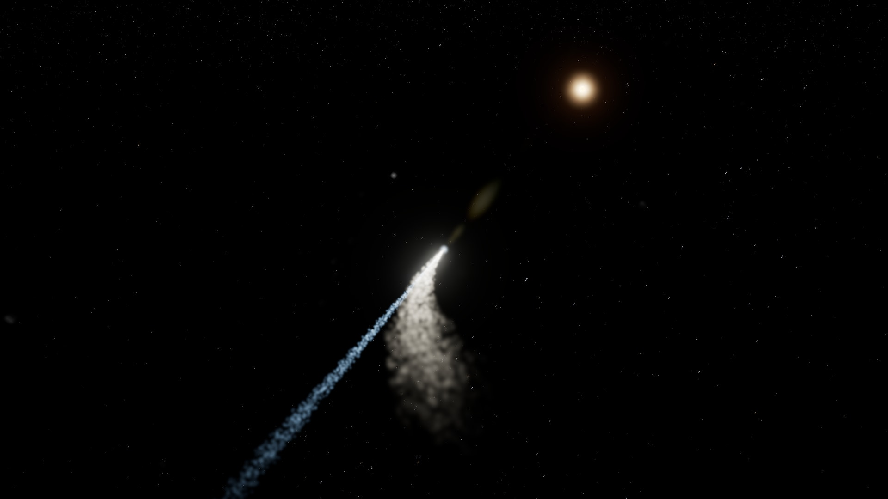<br><sub>Halley’s Comet near perihelion in 1986</sub></td>
  </tr>
  <tr>
    <td width="50%">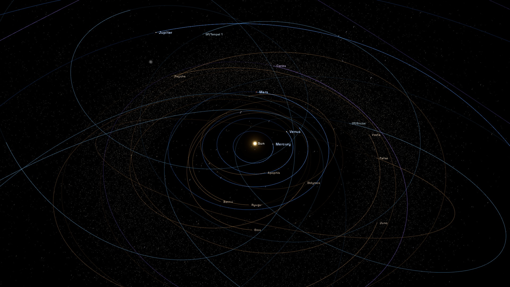<br><sub>The inner Solar System, true to scale</sub></td>
    <td width="50%">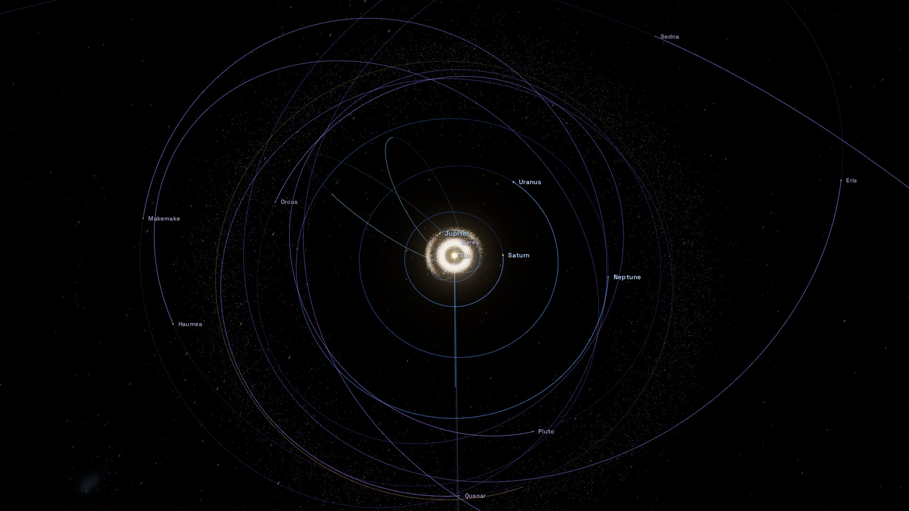<br><sub>The Kuiper belt beyond Neptune</sub></td>
  </tr>
  <tr>
    <td width="50%">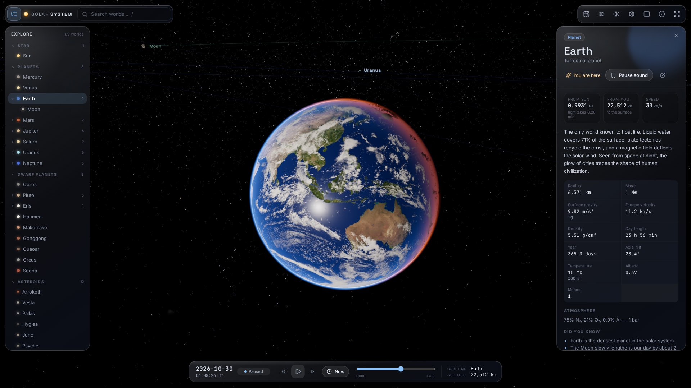<br><sub>Glass interface with live data for every world</sub></td>
    <td width="50%">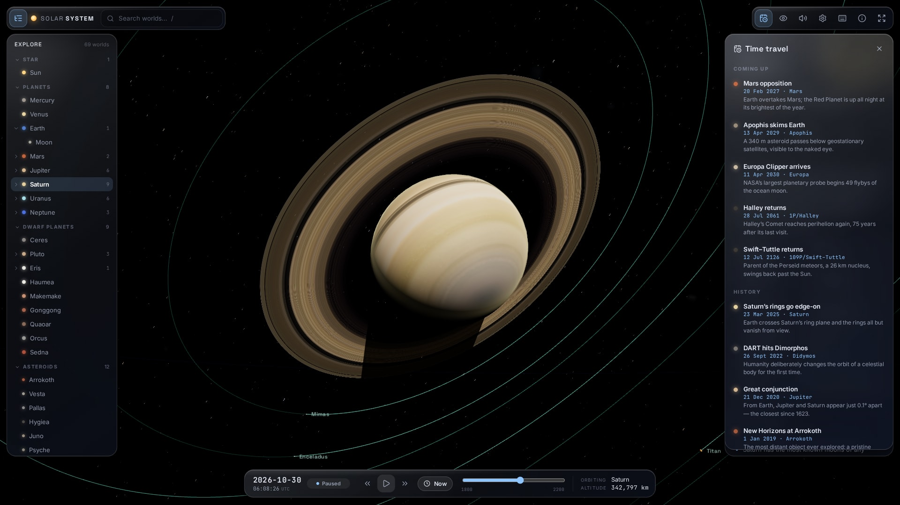<br><sub>Time-travel to historic and upcoming events</sub></td>
  </tr>
</table>
<!-- /auto:gallery -->

## Controls

| Mouse | |
| --- | --- |
| Drag | Orbit around the focused world |
| Scroll | Zoom, all the way out to the Oort cloud |
| Click / double-click | Select / fly to a world |

| Touch | |
| --- | --- |
| Drag | Orbit around the focused world |
| Pinch | Zoom, all the way out to the Oort cloud |
| Tap / double-tap | Select / fly to a world |
| Swipe a panel up / down | Open its full details / close it |

| Keyboard | |
| --- | --- |
| `0`–`9` | Fly to the Sun, Mercury … Pluto |
| `/` | Search |
| `Space` · `[` `]` · `N` | Pause · slower/faster (past zero runs backwards) · now |
| `F` | Fly to the selected world |
| `O` `L` `B` | Toggle orbits, labels, belts |
| `M` · `H` · `?` | Mute · hide the interface · all controls |

## Every world

<!-- auto:bodies -->
<details><summary><b>Star</b> (1)</summary>

| Name | Type | Radius | Surface | Sound |
| --- | --- | ---: | --- | --- |
| [Sun](https://en.wikipedia.org/wiki/Sun) | G2V main-sequence star | 695,700 km | 📷 spacecraft | 🎵 original |

</details>

<details open><summary><b>Planets</b> (8)</summary>

| Name | Type | Radius | Surface | Sound |
| --- | --- | ---: | --- | --- |
| [Mercury](https://en.wikipedia.org/wiki/Mercury_(planet)) | Terrestrial planet | 2,440 km | 📷 spacecraft | 🎵 original |
| [Venus](https://en.wikipedia.org/wiki/Venus) | Terrestrial planet | 6,052 km | 📷 spacecraft | 🎵 original |
| [Earth](https://en.wikipedia.org/wiki/Earth) | Terrestrial planet | 6,371 km | 📷 spacecraft | 🎛️ sonified |
| [Mars](https://en.wikipedia.org/wiki/Mars) | Terrestrial planet | 3,390 km | 📷 spacecraft | 🎵 original |
| [Jupiter](https://en.wikipedia.org/wiki/Jupiter) | Gas giant | 69,911 km | 📷 spacecraft | 🎵 original |
| [Saturn](https://en.wikipedia.org/wiki/Saturn) | Gas giant | 58,232 km | 📷 spacecraft | 🎵 original |
| [Uranus](https://en.wikipedia.org/wiki/Uranus) | Ice giant | 25,362 km | 📷 spacecraft | 🎵 original |
| [Neptune](https://en.wikipedia.org/wiki/Neptune) | Ice giant | 24,622 km | 📷 spacecraft | 🎵 original |

</details>

<details><summary><b>Dwarf planets</b> (9)</summary>

| Name | Type | Radius | Surface | Sound |
| --- | --- | ---: | --- | --- |
| [Ceres](https://en.wikipedia.org/wiki/Ceres_(dwarf_planet)) | Dwarf planet · asteroid belt | 470 km | 📷 spacecraft | 🎛️ sonified |
| [Pluto](https://en.wikipedia.org/wiki/Pluto) | Dwarf planet · Kuiper Belt | 1,188 km | 📷 spacecraft | 🎵 original |
| [Eris](https://en.wikipedia.org/wiki/Eris_(dwarf_planet)) | Dwarf planet · scattered disc | 1,163 km | 🎨 impression | 🎛️ sonified |
| [Haumea](https://en.wikipedia.org/wiki/Haumea) | Dwarf planet · Kuiper Belt | 780 km | 🎨 impression | 🎛️ sonified |
| [Makemake](https://en.wikipedia.org/wiki/Makemake) | Dwarf planet · Kuiper Belt | 715 km | 🎨 impression | 🎛️ sonified |
| [Gonggong](https://en.wikipedia.org/wiki/Gonggong_(dwarf_planet)) | Dwarf planet candidate · scattered disc | 615 km | ✨ procedural | 🎛️ sonified |
| [Quaoar](https://en.wikipedia.org/wiki/50000_Quaoar) | Dwarf planet candidate · Kuiper Belt | 555 km | ✨ procedural | 🎛️ sonified |
| [Orcus](https://en.wikipedia.org/wiki/90482_Orcus) | Dwarf planet candidate · plutino | 455 km | ✨ procedural | 🎛️ sonified |
| [Sedna](https://en.wikipedia.org/wiki/Sedna_(dwarf_planet)) | Dwarf planet candidate · sednoid | 497 km | ✨ procedural | 🎛️ sonified |

</details>

<details><summary><b>Moons</b> (31)</summary>

| Name | Type | Radius | Surface | Sound |
| --- | --- | ---: | --- | --- |
| [Moon](https://en.wikipedia.org/wiki/Moon) | Natural satellite · Earth | 1,737 km | 📷 spacecraft | 🎛️ sonified |
| [Phobos](https://en.wikipedia.org/wiki/Phobos_(moon)) | Martian moon · Mars | 11.08 km | 📷 spacecraft | 🎛️ sonified |
| [Deimos](https://en.wikipedia.org/wiki/Deimos_(moon)) | Martian moon · Mars | 6.2 km | 📷 spacecraft | 🎛️ sonified |
| [Io](https://en.wikipedia.org/wiki/Io_(moon)) | Galilean moon · Jupiter | 1,822 km | 📷 spacecraft | 🎛️ sonified |
| [Europa](https://en.wikipedia.org/wiki/Europa_(moon)) | Galilean moon · Jupiter | 1,561 km | 📷 spacecraft | 🎙️ recording |
| [Ganymede](https://en.wikipedia.org/wiki/Ganymede_(moon)) | Galilean moon · Jupiter | 2,634 km | 📷 spacecraft | 🎙️ recording |
| [Callisto](https://en.wikipedia.org/wiki/Callisto_(moon)) | Galilean moon · Jupiter | 2,410 km | 📷 spacecraft | 🎛️ sonified |
| [Amalthea](https://en.wikipedia.org/wiki/Amalthea_(moon)) | Inner moon of Jupiter · Jupiter | 83.5 km | ✨ procedural | 🎛️ sonified |
| [Himalia](https://en.wikipedia.org/wiki/Himalia_(moon)) | Irregular moon of Jupiter · Jupiter | 85 km | ✨ procedural | 🎛️ sonified |
| [Mimas](https://en.wikipedia.org/wiki/Mimas_(moon)) | Major moon of Saturn · Saturn | 198 km | 📷 spacecraft | 🎛️ sonified |
| [Enceladus](https://en.wikipedia.org/wiki/Enceladus) | Major moon of Saturn · Saturn | 252 km | 📷 spacecraft | 🎛️ sonified |
| [Tethys](https://en.wikipedia.org/wiki/Tethys_(moon)) | Major moon of Saturn · Saturn | 531 km | 📷 spacecraft | 🎛️ sonified |
| [Dione](https://en.wikipedia.org/wiki/Dione_(moon)) | Major moon of Saturn · Saturn | 561 km | 📷 spacecraft | 🎛️ sonified |
| [Rhea](https://en.wikipedia.org/wiki/Rhea_(moon)) | Major moon of Saturn · Saturn | 764 km | 📷 spacecraft | 🎛️ sonified |
| [Titan](https://en.wikipedia.org/wiki/Titan_(moon)) | Major moon of Saturn · Saturn | 2,575 km | 📷 spacecraft | 🎛️ sonified |
| [Hyperion](https://en.wikipedia.org/wiki/Hyperion_(moon)) | Moon of Saturn · Saturn | 135 km | ✨ procedural | 🎛️ sonified |
| [Iapetus](https://en.wikipedia.org/wiki/Iapetus_(moon)) | Major moon of Saturn · Saturn | 735 km | 📷 spacecraft | 🎛️ sonified |
| [Phoebe](https://en.wikipedia.org/wiki/Phoebe_(moon)) | Irregular moon of Saturn · Saturn | 107 km | ✨ procedural | 🎛️ sonified |
| [Miranda](https://en.wikipedia.org/wiki/Miranda_(moon)) | Major moon of Uranus · Uranus | 236 km | 📷 spacecraft | 🎛️ sonified |
| [Ariel](https://en.wikipedia.org/wiki/Ariel_(moon)) | Major moon of Uranus · Uranus | 579 km | 📷 spacecraft | 🎛️ sonified |
| [Umbriel](https://en.wikipedia.org/wiki/Umbriel_(moon)) | Major moon of Uranus · Uranus | 585 km | 📷 spacecraft | 🎛️ sonified |
| [Titania](https://en.wikipedia.org/wiki/Titania_(moon)) | Major moon of Uranus · Uranus | 788 km | 📷 spacecraft | 🎛️ sonified |
| [Oberon](https://en.wikipedia.org/wiki/Oberon_(moon)) | Major moon of Uranus · Uranus | 761 km | 📷 spacecraft | 🎛️ sonified |
| [Puck](https://en.wikipedia.org/wiki/Puck_(moon)) | Inner moon of Uranus · Uranus | 81 km | ✨ procedural | 🎛️ sonified |
| [Triton](https://en.wikipedia.org/wiki/Triton_(moon)) | Major moon of Neptune · Neptune | 1,353 km | 📷 spacecraft | 🎛️ sonified |
| [Proteus](https://en.wikipedia.org/wiki/Proteus_(moon)) | Inner moon of Neptune · Neptune | 210 km | ✨ procedural | 🎛️ sonified |
| [Nereid](https://en.wikipedia.org/wiki/Nereid_(moon)) | Irregular moon of Neptune · Neptune | 170 km | ✨ procedural | 🎛️ sonified |
| [Charon](https://en.wikipedia.org/wiki/Charon_(moon)) | Moon of Pluto · Pluto | 606 km | 📷 spacecraft | 🎛️ sonified |
| [Nix](https://en.wikipedia.org/wiki/Nix_(moon)) | Moon of Pluto · Pluto | 19 km | ✨ procedural | 🎛️ sonified |
| [Hydra](https://en.wikipedia.org/wiki/Hydra_(moon)) | Moon of Pluto · Pluto | 19 km | ✨ procedural | 🎛️ sonified |
| [Dysnomia](https://en.wikipedia.org/wiki/Dysnomia_(moon)) | Moon of Eris · Eris | 308 km | ✨ procedural | 🎛️ sonified |

</details>

<details><summary><b>Asteroids & Kuiper belt objects</b> (12)</summary>

| Name | Type | Radius | Surface | Sound |
| --- | --- | ---: | --- | --- |
| [Arrokoth](https://en.wikipedia.org/wiki/486958_Arrokoth) | Contact binary · Kuiper Belt | 9 km | ✨ procedural | 🎛️ sonified |
| [Vesta](https://en.wikipedia.org/wiki/4_Vesta) | Protoplanet · asteroid belt | 263 km | 📷 spacecraft | 🎛️ sonified |
| [Pallas](https://en.wikipedia.org/wiki/2_Pallas) | Asteroid belt | 256 km | ✨ procedural | 🎛️ sonified |
| [Hygiea](https://en.wikipedia.org/wiki/10_Hygiea) | Asteroid belt | 217 km | ✨ procedural | 🎛️ sonified |
| [Juno](https://en.wikipedia.org/wiki/3_Juno) | Asteroid belt | 127 km | ✨ procedural | 🎛️ sonified |
| [Psyche](https://en.wikipedia.org/wiki/16_Psyche) | Metal-rich asteroid | 111 km | ✨ procedural | 🎛️ sonified |
| [Eros](https://en.wikipedia.org/wiki/433_Eros) | Near-Earth asteroid | 8.42 km | ✨ procedural | 🎛️ sonified |
| [Bennu](https://en.wikipedia.org/wiki/101955_Bennu) | Near-Earth asteroid | 0.245 km | 📷 spacecraft | 🎛️ sonified |
| [Ryugu](https://en.wikipedia.org/wiki/162173_Ryugu) | Near-Earth asteroid | 0.448 km | 📷 spacecraft | 🎛️ sonified |
| [Itokawa](https://en.wikipedia.org/wiki/25143_Itokawa) | Near-Earth asteroid | 0.165 km | ✨ procedural | 🎛️ sonified |
| [Apophis](https://en.wikipedia.org/wiki/99942_Apophis) | Near-Earth asteroid | 0.17 km | ✨ procedural | 🎛️ sonified |
| [Didymos](https://en.wikipedia.org/wiki/65803_Didymos) | Binary near-Earth asteroid | 0.39 km | ✨ procedural | 🎛️ sonified |

</details>

<details><summary><b>Comets</b> (8)</summary>

| Name | Type | Radius | Surface | Sound |
| --- | --- | ---: | --- | --- |
| [1P/Halley](https://en.wikipedia.org/wiki/Halley%27s_Comet) | Halley-type comet | 5.5 km | ✨ procedural | 🎛️ sonified |
| [2P/Encke](https://en.wikipedia.org/wiki/Comet_Encke) | Encke-type comet | 2.4 km | ✨ procedural | 🎛️ sonified |
| [67P/Churyumov–Gerasimenko](https://en.wikipedia.org/wiki/67P/Churyumov%E2%80%93Gerasimenko) | Jupiter-family comet | 1.65 km | ✨ procedural | 🎛️ sonified |
| [9P/Tempel 1](https://en.wikipedia.org/wiki/Tempel_1) | Jupiter-family comet | 3 km | ✨ procedural | 🎛️ sonified |
| [81P/Wild 2](https://en.wikipedia.org/wiki/81P/Wild) | Jupiter-family comet | 2 km | ✨ procedural | 🎛️ sonified |
| [103P/Hartley 2](https://en.wikipedia.org/wiki/103P/Hartley) | Jupiter-family comet | 0.58 km | ✨ procedural | 🎛️ sonified |
| [109P/Swift–Tuttle](https://en.wikipedia.org/wiki/Comet_Swift%E2%80%93Tuttle) | Halley-type comet | 13 km | ✨ procedural | 🎛️ sonified |
| [C/1995 O1 Hale–Bopp](https://en.wikipedia.org/wiki/Comet_Hale%E2%80%93Bopp) | Long-period comet | 30 km | ✨ procedural | 🎛️ sonified |

</details>
<!-- /auto:bodies -->

## How it works

<!-- auto:stack -->
| Layer | Technology |
| --- | --- |
| Rendering | [three.js](https://threejs.org) 0.186.1 `WebGPURenderer` with TSL node materials; automatic WebGL 2 fallback |
| Post-processing | TSL render pipeline: bloom, lens flare, ACES filmic tone mapping |
| UI | [Svelte](https://svelte.dev) 5.57.3 (runes), Lucide icons, glass design system |
| Audio | Web Audio API: streamed soundtrack, spacecraft recordings, real-time synthesis for sonifications, convolution reverb |
| Build | [Vite](https://vite.dev) 8.3.5 (Rolldown), [TypeScript](https://www.typescriptlang.org) 6.0.3, [Biome](https://biomejs.dev) 2.6.4, [Vitest](https://vitest.dev) 5.0.5 |
| Assets | sharp, ffmpeg, KTX-Software and JPL Horizons scripts, all run in Docker; maps ship as WebP plus GPU-compressed KTX2 (Basis Universal) |
| Delivery | GitHub Actions → Docker build → [butler](https://itch.io/docs/butler/) → itch.io, plus [GitHub Pages](https://e-choness.github.io/solar-system-engine/) |
<!-- /auto:stack -->

- **Coordinates.** Bodies are positioned in heliocentric J2000 ecliptic kilometres in float64 on the CPU. Each frame the camera sits at the origin and everything is placed relative to it, so the GPU’s float32 never sees a large number. A logarithmic depth buffer spans 1 m to 100 light-years.
- **Orbits.** Planets use JPL’s Keplerian elements with per-century rates. Moons, dwarf planets, asteroids and comets use osculating elements from JPL Horizons with fitted precession rates. Earth–Moon and Pluto–Charon orbit their barycentres.
- **Orientation.** IAU pole and prime-meridian models orient each body; textures are aligned to each map’s longitude convention.
- **Belts.** 95,000 particles for the main belt, Jupiter’s Trojans, the Kuiper belt and the Oort cloud solve Kepler’s equation per vertex on the GPU, with Kirkwood gaps in the main belt.
- **Accuracy.** Planet positions are good to well under a degree from 1800 to 2050. Moons and small bodies drift the further a date is from 2026, and close flybys such as Apophis are approximate, because two-body orbits ignore planetary perturbations.

## Development

Everything runs in Docker: nothing is installed on the host.

```sh
docker compose up dev                                # dev server on http://localhost:5173 (DEV_PORT=8173 to change)
docker compose run --rm node npm run check           # svelte-check + Biome
docker compose run --rm node npm test                # unit tests (astronomy, frames, orbits)
docker compose run --rm node npm run build           # production build in dist/
docker build --target dist --output type=local,dest=dist .   # clean build, exported to dist/
```

Asset and data pipelines:

```sh
docker compose run --rm node npm run assets          # download and optimise maps, recordings, star catalogue
docker compose run --rm node npm run assets ktx2     # re-encode the GPU-compressed KTX2 tiers from the shipped maps
docker compose run --rm node npm run ephemeris       # refresh orbital elements from JPL Horizons
docker compose run --rm browser node scripts/smoke.mjs earth saturn   # headless screenshots in .cache/smoke
docker compose run --rm browser npm run media        # regenerate the media kit (needs the dev server)
docker compose run --rm browser npm run trailer      # capture the trailer frame by frame (needs the dev server)
docker compose run --rm node npm run trailer:encode  # mux frames + soundtrack into media/trailer.mp4
docker compose run --rm node npm run readme          # refresh this README and CREDITS.md
```

## Publishing

Every push to `main` runs [`.github/workflows/publish.yml`](.github/workflows/publish.yml). It builds and tests inside Docker, then pushes `dist/` to [itch.io](https://echoness.itch.io/solar-system) with butler on the `html5` channel, versioned from `package.json`. The workflow reads the itch.io API key from the `BUTLER_API_KEY` repository secret (`BUTLER_CREDENTIALS` and `ITCH_API_KEY` are also accepted).

The same push also runs [`.github/workflows/pages.yml`](.github/workflows/pages.yml), which builds the same Docker target and deploys `dist/` to [GitHub Pages](https://e-choness.github.io/solar-system-engine/). The build uses relative URLs, so it runs unchanged under the repository's `/solar-system-engine/` path. Pages must be set to deploy from **GitHub Actions** (Settings → Pages → Source).

## Media kit

Everything in [`media/`](media) is generated from the live app by `npm run media`:

| File | Use |
| --- | --- |
| [`cover.png`](media/cover.png) | itch.io cover image (630×500) |
| [`banner.png`](media/banner.png) · [`banner@2x.png`](media/banner@2x.png) | itch.io page banner (960×300 and 1920×600) |
| [`background.jpg`](media/background.jpg) | itch.io page background (2560×1440) |
| [`social-card.png`](media/social-card.png) | Open Graph / social preview (1200×630) |
| [`logo.png`](media/logo.png) | Square icon (512×512) |
| [`screenshots/`](media/screenshots) | 1920×1080 in-app screenshots |
| [`trailer.mp4`](media/trailer.mp4) · [`trailer-poster.jpg`](media/trailer-poster.jpg) | Feature trailer, 1080p30 with the original soundtrack (`npm run trailer`) |

## Credits

<!-- auto:credits -->
- **Surface maps:** 44 maps from Solar System Scope (CC BY 4.0), NASA/JPL/USGS (public domain) and Askaniy (CC BY-SA 3.0).
- **Shape models:** 6 measured comet and asteroid shapes from the NASA Planetary Data System (public domain) and ESA’s Rosetta mission.
- **Recordings:** 2 NASA Juno Waves recordings (NASA/JPL-Caltech/SwRI/University of Iowa).
- **Data:** JPL Horizons and Standish planetary elements (NASA/JPL), IAU WGCCRE rotation models, Yale Bright Star Catalogue (via CDS VizieR).
- **Original music and sounds:** _Solar System_ (2021) by Echo Yin.

Every file and its license is listed in **[CREDITS.md](CREDITS.md)**.
<!-- /auto:credits -->

## License

Non-commercial. Source code is licensed under the [PolyForm Noncommercial License 1.0.0](LICENSE.md). Music and sounds from the original game are © Echo Yin. Third-party maps, recordings and data keep their own licenses: see [LICENSE.md](LICENSE.md) and [CREDITS.md](CREDITS.md).

<!-- auto:updated -->
<sub>Generated by `npm run readme` · v2.0.0 · 2026-11-02</sub>
<!-- /auto:updated -->
